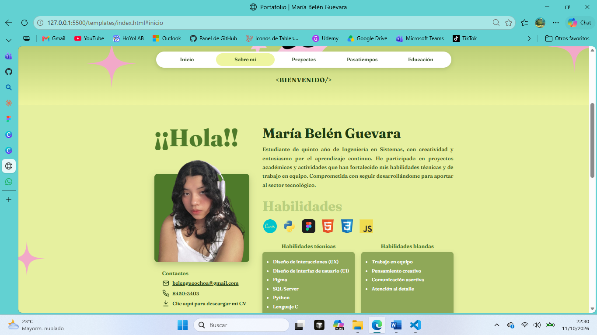

# 🌿 Guía semana 11 – Portafolio personal con HTML ✨

📚 **Curso:** Diseño de sistemas en Internet
👩‍💻 **Estudiante:** María Belén Guevara Ochoa
🏫 **Universidad:** Universidad Nacional de Ingeniería (UNI)
🔗 **Repositorio:** [github.com/Mbelem7/GuiaFbasico](https://github.com/Mbelem7/GuiaFbasico)

---

## 🎯 Objetivo

Identificar la estructura básica del **frontend** mediante **HTML**, organizando correctamente los elementos de una página web.

## 📝 Descripción

Portafolio personal basado en mi propio diseño hecho en **Figma** 🎨. El código está separado por responsabilidad: la estructura en HTML, el diseño en CSS y el comportamiento en JavaScript.

### ✅ Requisitos del taller

| Requisito | ¿Dónde está? |
|---|---|
| 📄 Archivo `index.html` | `templates/index.html` |
| 🏷️ Encabezado principal con mi nombre | `<h1>` "María Belén Guevara" en la sección *Sobre mí* |
| 💬 Párrafo de presentación personal | Debajo de mi nombre |
| 📋 Lista de intereses y habilidades | Habilidades técnicas, blandas, proyectos y pasatiempos |
| 🖼️ Imagen | Avatar, fotografía y galería de certificados |
| 🔗 Enlaces a redes y sitios | LinkedIn, correo, GitHub, Instagram, Linktree y descarga de mi CV |

## 🧱 Etiquetas utilizadas

| Etiqueta | Uso en la página |
|---|---|
| `<html>` | Elemento raíz del documento |
| `<head>` | Metadatos, título, fuente y enlace a la hoja de estilos |
| `<body>` | Contenido visible de la página |
| `<h1>` | Mi nombre (encabezado principal, único en la página) |
| `<h2>` | Títulos de sección: ¡¡Hola!!, Habilidades, Educación, Proyectos, Pasatiempos |
| `<h3>` | Subtítulos: Contactos, tarjetas de habilidades, Diplomas, Participaciones |
| `<h4>` | Título "Redes" en el pie de página |
| `<h5>` | Nombre del curso y la guía en el pie de página |
| `<h6>` | Derechos reservados |
| `<p>` | Presentación personal y textos |
| `<ul>` / `<li>` | Menú, habilidades, certificados, participaciones, proyectos y redes |
| `` | Avatar, fotografía, íconos y certificados |
| `<a>` | Menú de navegación, redes, correo, teléfono y descarga del CV |

➕ También se usan etiquetas semánticas: `<nav>`, `<header>`, `<main>`, `<section>` y `<footer>`.

## 📁 Estructura del proyecto

```
GuiaFbasico/
├── 📄 README.md
├── 📂 templates/
│   └── index.html              → estructura de la página (HTML)
└── 📂 static/
    ├── 📂 styles/
    │   └── styles.css          → estilos y diseño (CSS)
    ├── 📂 js/
    │   └── main.js             → menú activo e imágenes opcionales (JS)
    └── 📂 assets/
        ├── 📂 docs/
        │   └── CV-Maria-Belen-Guevara.pdf
        └── 📂 img/
            ├── avatar.png
            ├── foto-belen.png
            ├── udemy-figma.jpg
            ├── cs50-harvard.jpg
            ├── certificado-cnit.jpg
            ├── logo-uni.png
            └── hackathon-entornos-2024.jpg
```

## 🛠️ Tecnologías

- 🟧 **HTML5**: estructura y contenido
- 🟦 **CSS3**: diseño, colores, degradados y adaptación a celular 📱
- 🟨 **JavaScript**: resalta en el menú la sección visible al hacer scroll
- 🎨 **Figma**: diseño previo del portafolio

## 🚀 Cómo verlo

1. 📥 Clonar el repositorio:
   ```bash
   git clone https://github.com/Mbelem7/GuiaFbasico.git
   ```
2. 🌐 Abrir `templates/index.html` en el navegador, o usar la extensión **Live Server** de VS Code.
3. 📶 Tener conexión a internet para cargar la fuente y los íconos.

## 📸 Captura



---

💚 Hecho por **María Belén Guevara** · 2026